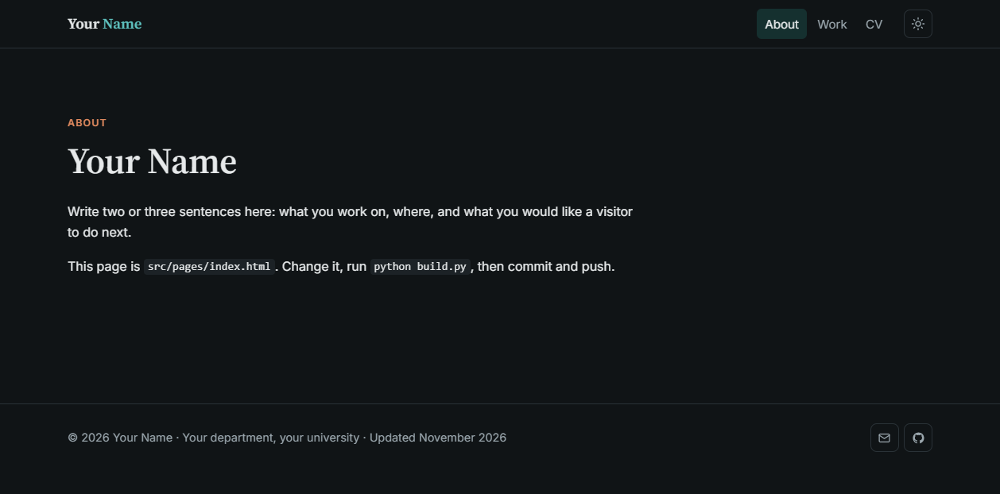

# Academic site template

A plain personal website for researchers, teachers and writers. It has light and dark themes, works on phones, and needs only Python to build. GitHub Pages hosts it free of charge.

## Use it

1. Press **Use this template** on this page and name the new repository `your-username.github.io`.
2. Change the lines in `site.toml` and the pages in `src/pages/`.
3. Run `python build.py`, then commit and push.
4. In the repository, open **Settings**, then **Pages**, and choose to deploy from the `main` branch.

The step-by-step guide, with a picture of each screen and no prior knowledge assumed, is at <https://ahmadammar.github.io/teaching/site-setup/>.

## How it is arranged

| File or folder | What it holds |
|---|---|
| `site.toml` | Your name, address, menu and links |
| `src/pages/` | The text of each page |
| `assets/` | The theme: colours, layout and small scripts |
| `build.py` | Puts each page inside the layout |

Your details live only in `site.toml` and `src/pages/`, so a newer theme can replace `assets/` and `build.py` without touching your text. Theme versions are listed in `CHANGELOG.md` and tagged in git.
